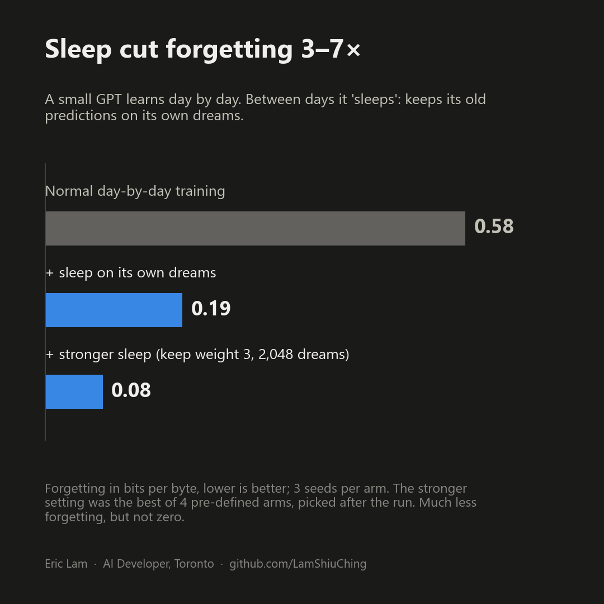
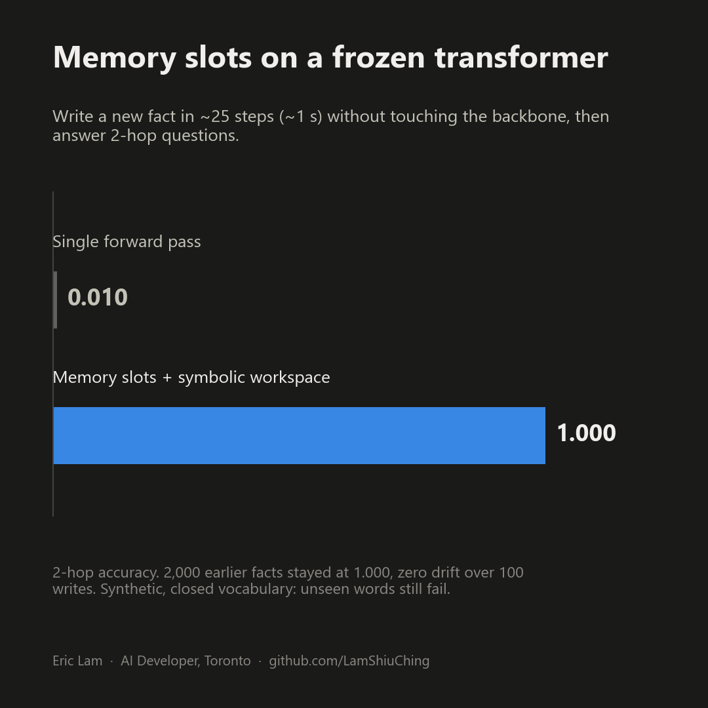
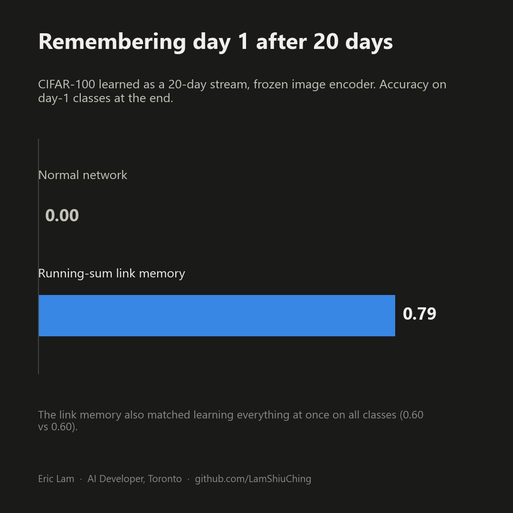
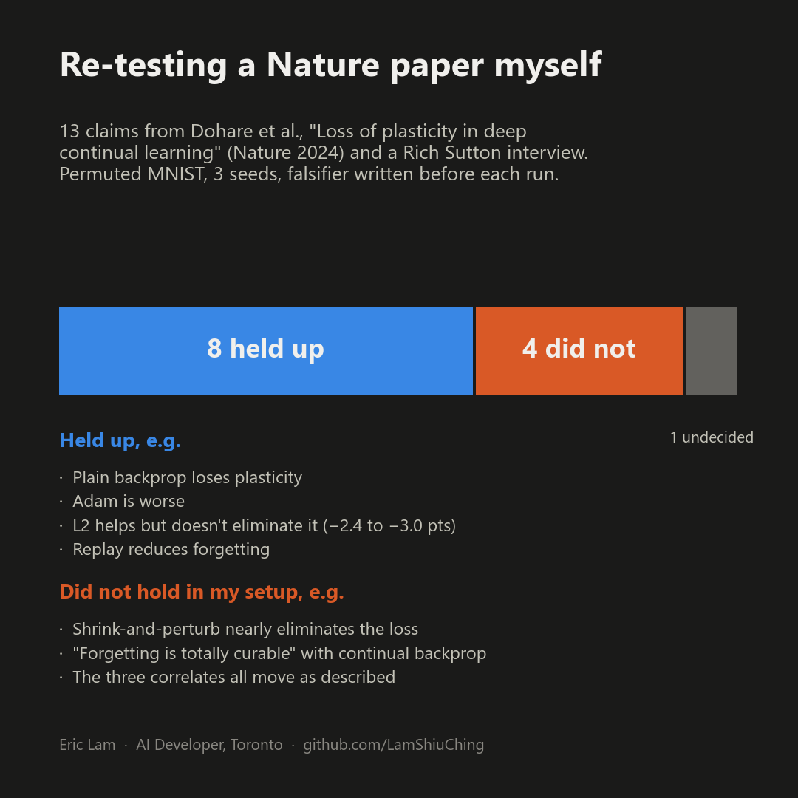
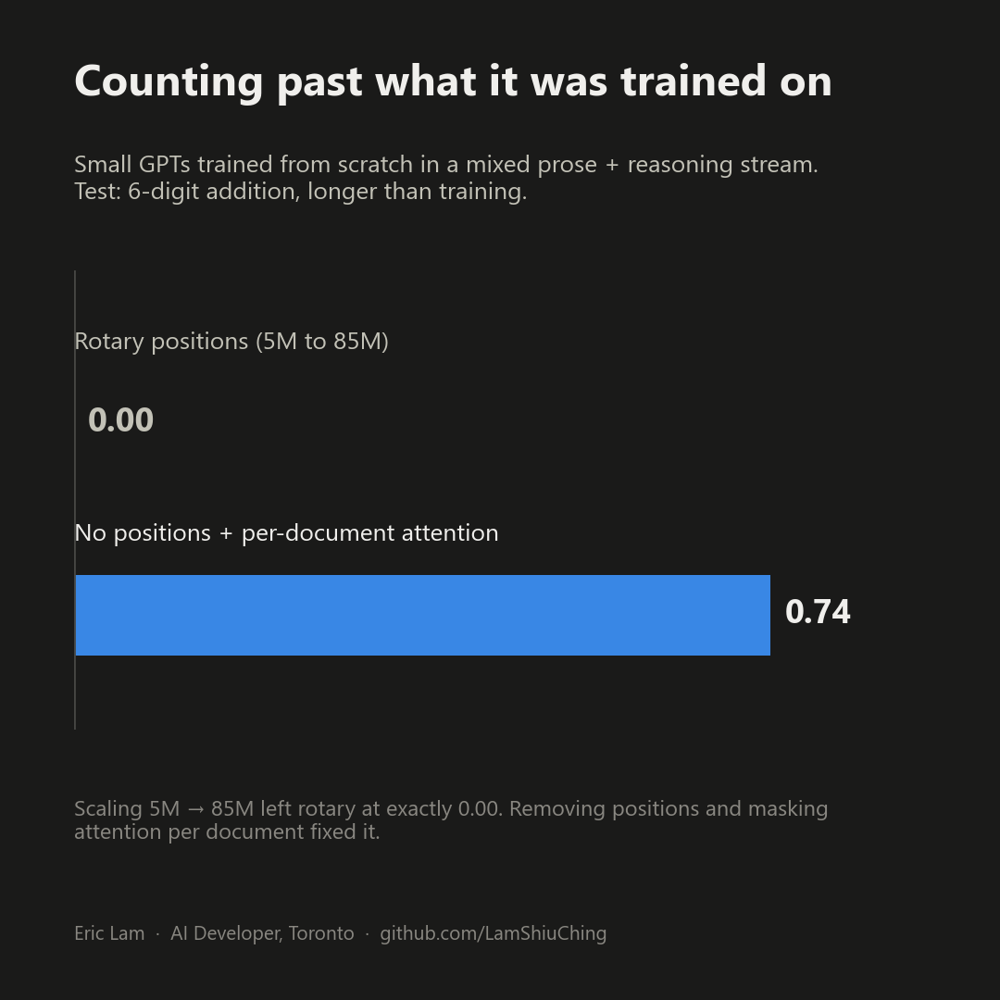
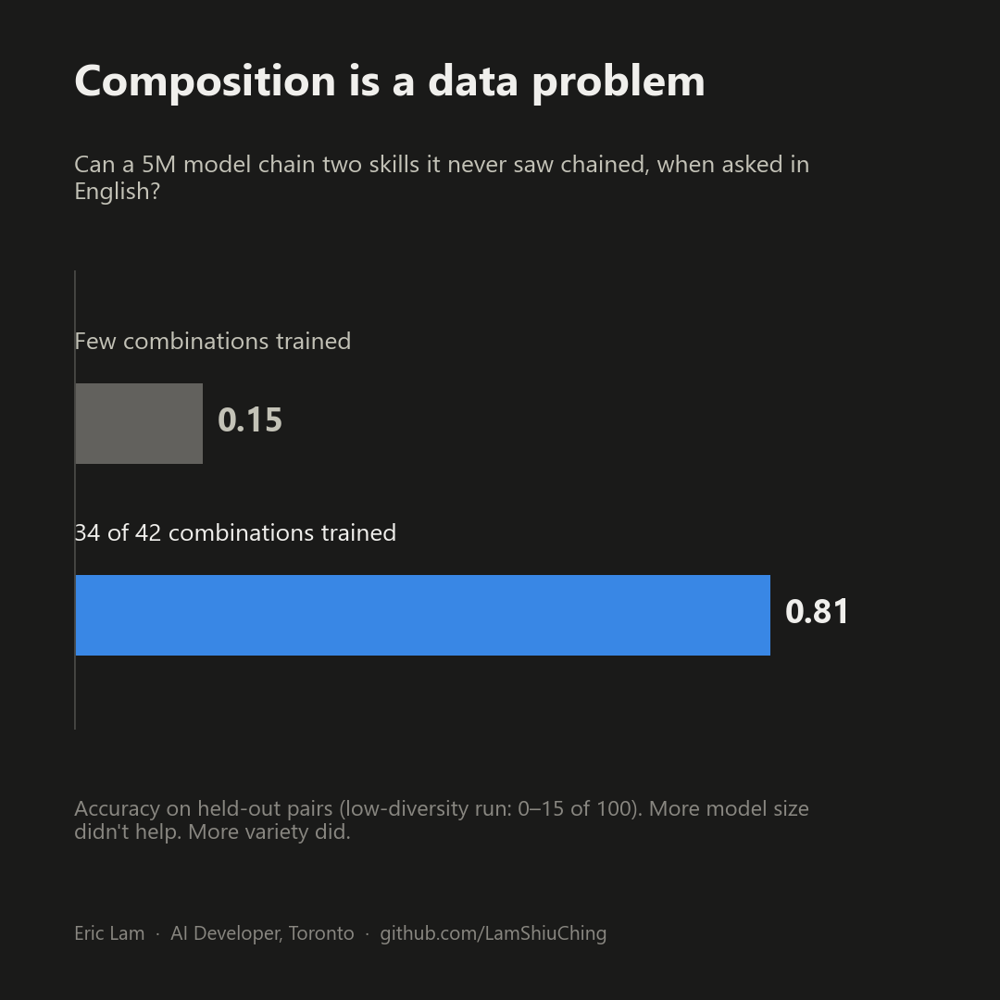
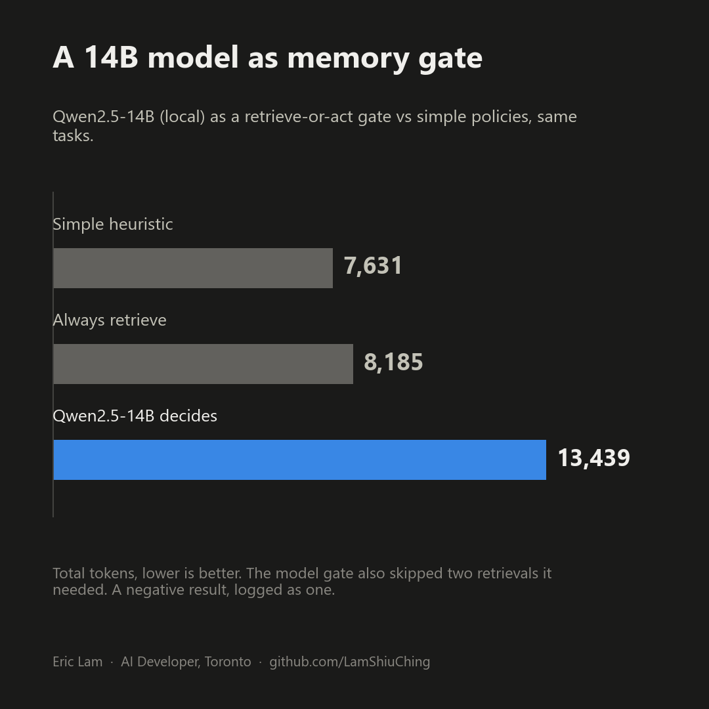

# AI research log & ideas

**Eric Lam** · AI developer, Toronto · Aug – Oct 2026

Can a model keep learning after training without forgetting what it already knows? I spent two months
testing that question on one GPU (RTX 4080 SUPER, plus about $5 of cloud). This repo is the log: the
idea, every experiment, the numbers, and what failed.

## The idea

Today's LLMs learn once, then their weights freeze. Whatever they figure out in a conversation is gone
when it ends. Brains split the job instead:

- **Fast memory** ("hippocampus") writes new experience in seconds.
- **Sleep & replay** moves what matters into long-term storage without overwriting the old.
- **Slow shared weights** ("cortex") hold general skill.

I built small versions of each piece and tried to break them. For most experiments I wrote the pass/fail
bar before running, used controls, and ran multiple seeds.

## Results that held up

| | |
|---|---|
|  |  |
|  |  |
|  |  |

And one negative result, kept on purpose:

## Every experiment

Numbers are copied from each project's own reports. 🔓 = public code.
**Full write-ups:** [24 project logs and 15 short papers](logs/) · **Code:** [core code for 5 experiments](experiments/)

| Dates | Project | Question | Key result | Status |
|---|---|---|---|---|
| Aug 13–16 | BabyBrain byte lab | Can a ~140k-param model with replay, curiosity and planning learn in tiny worlds? | Planner 98–100% vs random 16–24%; SSM memory 0.98–0.99 out to 254 keys. Curiosity chased noise 84–92% of the time | Concluded |
| Aug 16–19 | Javis, phases 2–4 | Can a from-scratch model learn rules it never saw? Then: a compression model + searched program library | Library model used 4.4× fewer bits on computational data, beating xz 2.3×. Call depth didn't generalize (~0.2 at depth 5) | Concluded |
| Aug 19–20 | Generative Learning Transformer | Fact memory slots on a frozen backbone | Fact written in ~1 s; 2,000 earlier facts kept at 1.000; 2-hop 1.000 vs 0.010. Unseen words: 0.000 | Paused |
| Aug 20 | Consolidation agent + CAM | Frozen base + learner fork + verified pool; hypervector program learner | With a model judge instead of ground truth, gains stalled; CAM falsified on transfer | Abandoned |
| Aug 31 – Sep 1 | eureka: *Learning by Accretion* | Keep knowledge, source trust and skills outside a frozen core (nanoGPT 10–89M, SmolLM3-3B) | Provenance channel beat a lying majority 97 vs 29; fabrication 100% → 30%. Prompt-only baseline beat LoRA + provenance (73 vs 47) | Paper written, parked |
| Sep 1–3 | Continual learning claims | Re-test Dohare et al. (Nature 2024) on permuted MNIST | 13 claims: 8 held up, 4 didn't, 1 undecided | Concluded |
| ~Sep 5 | Self-improvement loops | When does a model improve itself vs drift? | Verified + exploration: pass@100 0.85 vs self-judging 0.30 | Theory note |
| Sep 6–8 | OPAL | DreamCoder-style program induction with a learned library, plus LLM proposers | Library agent 6/12 rules vs 3/12 for controls; cross-domain transfer 0/9 | Concluded |
| Sep 8–9 | Small adaptive systems | Can tiny learners improve through experience? | Hybrid memory: old tasks 41.9% → 60.6%, but new tasks slowed | Concluded |
| Sep 10 | Executive control + MemRL | Should the model decide when to recall memory? | Qwen2.5-14B gate used 64–76% more tokens and missed needed retrievals; MemRL not reproduced | Closed |
| Sep 11–12 | Fruit-fly connectome | Does real fly wiring learn faster than standard nets? | No: GRU won odor conditioning 4/4; no RL advantage with any plasticity rule | Concluded |
| Sep 11–12 | Verified deduction | Can a small transformer learn checkable multi-step proofs? | 10.8M model: 107/150 correct, 41/150 valid proofs; depth 3–4: nearly none | Stopped |
| Sep 13–16 | [LM optimization](https://github.com/LamShiuChing/LM-optimization) 🔓 | How do small GPTs (5M–85M) learn reasoning? 31 findings | Rotary 0.00 vs no-position + doc-mask 0.74 length extrapolation; held-out composition ≤0.15 → 0.81 with more diverse data | Models published |
| Sep 1–16 | Compact continual learners | Frozen MiniLM + online heads on BANKING77 / CLINC150 | 84.15% on held-out domains at 4-shot, but a simple prototype memory still won | Milestones done |
| Sep 17–20 | Decision model (LCM) | One trained scorer (DeBERTa 141M) for answers and memory/tool actions | NLI 30.7% → 65.8%, Boolean 50.0% → 84.8%; but routing regressed 32 → 13/32 and diagnostic transfer was 0/48 | Paused |
| Sep 19 | Generative proposer | Can a CVAE (96k params) design Boolean circuits? | 5/576 vs 7/576 for retrieval + mutation: no advantage | One run |
| Sep 21 | [ELM](https://github.com/LamShiuChing/Language-Model-Optimization) 🔓 | LoRA-tune a small model into a local tool-using agent | Qwen3-0.6B: 19/22 on a dev benchmark, live web 3/4 | Ongoing |
| Sep 25 – Oct 2 | ARC-AGI-3 agents | Interactive puzzle games | Random 0.05%; best (curious agent) 1.82% | Ongoing |
| Sep 26–29 | Brain-like continual learner | Fact memory + slots + sleep + continual GPT | Sleep: forgetting 0.58 → 0.19 (stronger sleep: 0.08); CIFAR-100 day-1 0.79 vs 0.00; 1D-ARC 144 → 152. A 13-day Wikipedia stream still forgot | Stopped: "too shallow" |
| Oct 1–5 | Locked blocks | Never-forgetting blocks for a language model (124M, BLiMP 0.766) | Locked blocks never forget, but a normal GPT was 6% better on unseen kinds | Ongoing |

## What I learned

1. **Simple baselines beat clever mechanisms more often than you'd think.** Prototypes, lookup tables
   and symbolic solvers matched or beat many learned versions. Better to find that out in a day.
2. **Generalization came from data diversity and outside verification**, not from model size or
   self-checking.
3. **Dense shared weights forget.** Replay, sleep and regularization only partly fix it.

**Next:** architectures where new learning doesn't overwrite old knowledge, running on a local device.

## Things I shipped along the way

- **Moji**: real-time voice English tutor (Gemini Live, FastAPI, React). I use it daily.
- [**Resume Tailor**](https://github.com/LamShiuChing/Resume-App) 🔓: local resume tailoring with Gemini.
- [**Are LLMs replacing software engineers?**](https://github.com/LamShiuChing/IT-job-post-LLM) 🔓: Indeed Hiring Lab data, 4 countries.
- **LLM intraday trader**: two Claude agents (analyst + executive) with hard risk checks in code.
- **Games built with AI**: Infinite Elevator, Tanks!, Monochrome Rush.

## Files

- `assets/idea-map.mp4` / `.gif`: animated overview (1080×1080)
- `assets/linkedin-carousel.pdf`: all slides and charts as one carousel
- `logs/`: one write-up per project; `logs/papers/`: short papers (PDF + markdown source)
- `experiments/`: core code and original reports for five experiments
- `tools/make_assets.py`: regenerates the visuals (`python tools/make_assets.py`; needs Pillow, matplotlib, ffmpeg)
- `tools/md_to_pdf.py`: rebuilds the paper PDFs (needs `markdown` and Chrome)

Open to AI/ML engineer and software engineer roles (front end, back end, full stack) in Toronto or remote ·
[LinkedIn](https://www.linkedin.com/in/lamshiuchingeric/)
